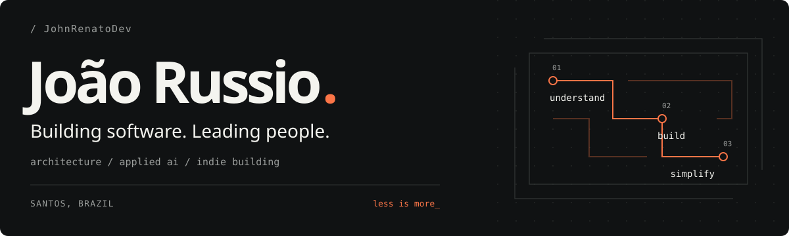

<picture>
  <source media="(prefers-color-scheme: dark)" srcset="github-profile-assets/hero-dark.svg">
  <source media="(prefers-color-scheme: light)" srcset="github-profile-assets/hero-light.svg">
  
</picture>

### About me

I'm João, a Brazilian software engineer and **Head of Forward Deployed Engineering at [Mosten](https://github.com/Mosten)**. I turn business problems into useful software, lead engineering teams, and stay close to the problem until it's solved.

I work on software architecture and applied AI, with the product in mind. I like systems that are easy to understand, tools that earn their place, and teams that can ship products that truly solve problems.

#### On my workbench

- Designing systems people can maintain and modernizing existing software.
- Building AI agents, integrations, and automation for everyday work.
- Making small products on the side and exploring better ways to work.

#### Tools I reach for

`TypeScript` `Node.js` `.NET` `Python` `Go` `Laravel` 
`React` `Angular` `PostgreSQL` `Docker` `Azure` `AWS`

---

Outside work, I enjoy books and coffee.

[Portfolio](https://johnrenatodev.github.io/) · [Writing](https://russios-blog.pages.dev/) · [LinkedIn](https://www.linkedin.com/in/johnrenatodev/) · [X](https://x.com/JohnRussio)
